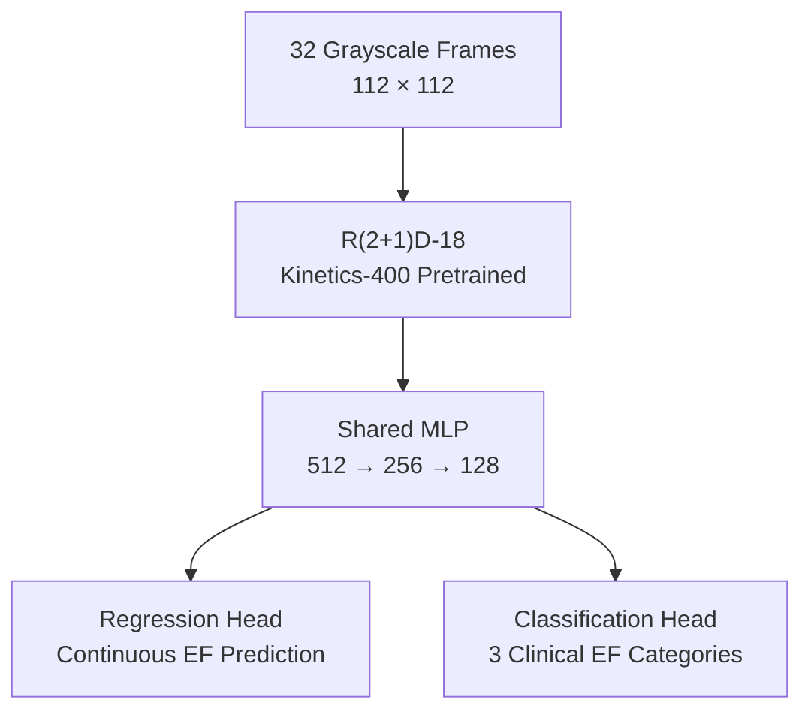

# Ejection Fraction Estimation Using an R(2+1)D-18 CNN

A second-year undergraduate group research project exploring automated left ventricular ejection fraction (LVEF) estimation from echocardiogram videos using a spatiotemporal convolutional neural network (CNN).

The project reproduces and extends Stanford's EchoNet-Dynamic approach (Ouyang et al., 2020), using a Kinetics-400-pretrained R(2+1)D-18 backbone for video-based EF regression and clinical classification. Additional experiments investigate multi-task learning, calibration, uncertainty-aware inference and model interpretability.

**Research report:** [Read the full paper](reports/Ejection%20Fraction%20Estimation%20Using%20an%20R(2%2B1)D-18%20Convoluted%20Neural%20Network.pdf)

## Overview

Left ventricular ejection fraction is the percentage of blood pumped out of the left ventricle with each heartbeat. Estimating EF from echocardiograms is important for assessing cardiac function, but manual measurements can be time-consuming and dependent on image quality and operator expertise.

Using the EchoNet-Dynamic dataset, this project investigates whether a deep learning model can estimate EF directly from ultrasound video while identifying uncertain predictions for expert review.

**Key results on the test set:**

| Metric | Result |
|---|---:|
| Mean Absolute Error (MAE) | 4.10 percentage points |
| Root Mean Squared Error (RMSE) | 5.55 percentage points |
| Coefficient of Determination (\(R^2\)) | 0.794 |
| Classification accuracy (post-hoc evaluation) | 80.6% |
| Accuracy on retained predictions at 75.7% coverage | 95% |

The uncertainty-aware evaluation defers approximately 24% of cases for clinician review rather than attempting to classify every case automatically. These results are from an experimental research pipeline, not a clinically validated diagnostic system.

## Model Architecture

The model uses an **R(2+1)D-18** backbone pretrained on Kinetics-400. It factorises 3D convolutions into separate spatial and temporal operations, allowing it to learn both cardiac appearance and motion over time.

The network accepts 32 grayscale frames at 112 × 112 resolution. The pretrained input convolution is adapted from three colour channels to one by averaging its RGB weights.

A shared multilayer perceptron (MLP) produces an embedding for two parallel output heads:

- **Regression:** predicts a continuous EF value.
- **Classification:** predicts one of three clinical EF categories.

The two tasks are trained jointly using a weighted combination of mean squared error and cross-entropy loss.



### Clinical Categories

| Category | EF range |
|---|---|
| Reduced | Below 40% |
| Mildly Reduced | 40–49% |
| Preserved | 50% or above |

## Key Features

- **Transfer learning:** adapts pretrained video-recognition weights to grayscale echocardiograms.
- **Multi-task learning:** combines continuous EF regression with three-class classification using a shared representation.
- **Video preprocessing and augmentation:** samples temporally consistent clips, resizes frames and applies spatial augmentation.
- **Post-hoc calibration:** evaluates ten-clip test-time augmentation, temperature scaling and recall-aware classification thresholds.
- **Uncertainty-aware inference:** uses classification confidence to defer uncertain predictions for expert review.
- **Grad-CAM visualisation:** highlights image regions influencing predictions, supporting qualitative interpretability analysis.
- **Ablation study:** compares the full model against reduced-frame, non-pretrained, regression-only and separate-head variants.
- **Statistical evaluation:** reports regression and classification metrics, subgroup performance and 95% bootstrap confidence intervals.

## Ablation Study

The experiments investigate the contribution of key architectural and training choices.

| Configuration | MAE | Classification accuracy |
|---|---:|---:|
| Full model (32 frames) | 4.10% | 87.1% |
| 16-frame input | 4.62% | 84.6% |
| No pretraining | 10.24% | 80.9% |
| Regression-only | 4.38% | 77.6% |
| No shared head | 4.19% | 84.4% |

*These ablation results use the default classification thresholds without test-time augmentation or temperature scaling, so they are not directly comparable with the post-hoc calibrated results above.*

The largest regression performance drop occurred without Kinetics-400 pretraining, highlighting the importance of transfer learning for this medical video task.

## Repository Structure

```text
├── main.py                  # Training and evaluation entry point
├── app/
│   └── start.py             # GUI for single-video inference
├── src/
│   ├── CNN_model.py         # R(2+1)D-18 model architecture
│   ├── config.py            # Hyperparameters and dataset paths
│   ├── data_processing.py   # Dataset loading and preprocessing
│   ├── training.py          # Training loop and optimisation
│   └── analysis.py          # Evaluation and analysis tools
├── artifacts/
│   ├── best_r2plus1d.pt     # Best model checkpoint
│   ├── dataset_statistics.json
│   ├── ablation/            # Ablation checkpoints
│   ├── evaluation/          # Test predictions
│   └── gradcam/             # Visualisation outputs
├── dataset/                 # Dataset files (not included)
├── reports/
│   └── Ejection Fraction Estimation Using an R(2+1)D-18
│       Convoluted Neural Network.pdf
└── setup/
    ├── requirements.txt
    ├── setup.bat            # Windows setup
    └── setup.sh             # Linux/macOS setup
```

## Setup and Usage

### 1. Download the Dataset

Download [EchoNet-Dynamic from Kaggle](https://www.kaggle.com/datasets/mahnurrahman/echonet-dynamic) and place the dataset files in the `dataset/` directory.

Expected structure:

```text
dataset/
├── FileList.csv
├── VolumeTracings.csv
└── Videos/
```

To use a different dataset location, create `local_config.json` in the project root:

```json
{
  "DATASET_PATH": "/path/to/your/dataset"
}
```

### 2. Install Dependencies

**Windows**

```bat
setup\setup.bat
```

**Linux / macOS**

```bash
chmod +x setup/setup.sh
./setup/setup.sh
```

The setup scripts create a virtual environment and install the required dependencies. Check `setup/requirements.txt` for the PyTorch and CUDA configuration and adjust it to match your system if necessary.

### 3. Run the Pipeline

Activate the virtual environment, then run:

```bash
python main.py
```

The pipeline orchestrates training, evaluation, calibration, Grad-CAM analysis and ablation experiments. Training is skipped automatically if `artifacts/best_r2plus1d.pt` already exists.

### 4. Run the Inference GUI

```bash
python app/start.py
```

The GUI provides an interface for running inference on an individual echocardiogram video.

## Training Configuration

| Parameter | Value |
|---|---|
| Backbone | R(2+1)D-18, Kinetics-400 pretrained |
| Input | 32 grayscale frames, 112 × 112 |
| Batch size | 16 |
| Optimiser | SGD, momentum 0.9 |
| Initial learning rate | 1 × 10⁻⁴ |
| Learning-rate scheduler | StepLR, factor 0.1 every 15 epochs |
| Maximum epochs | 45 |
| Early stopping | Patience of 10 epochs |
| Dropout | 0.5 |

The model was implemented in PyTorch and trained on an NVIDIA RTX 5090 GPU. Hyperparameters and paths are centralised in `src/config.py`.

## References

- Ouyang, D. et al. (2020). *Video-based AI for beat-to-beat assessment of cardiac function.* Nature, 580, 252–256.
- Tran, D. et al. (2018). *A Closer Look at Spatiotemporal Convolutions for Action Recognition.* CVPR.

## Limitations

This project uses a single dataset and has not undergone external multi-site validation or prospective clinical evaluation. Performance can degrade with poor image quality, obscured ventricular boundaries and borderline EF values. Softmax confidence is an imperfect measure of uncertainty, and the model is intended for research into clinical decision support rather than replacing clinicians.

## Acknowledgements

This was a second-year undergraduate group coursework project. The accompanying research paper documents the methodology, experiments, results and limitations. Git history may not fully represent each group member's contributions.
